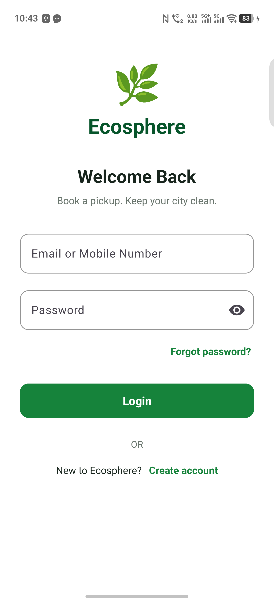
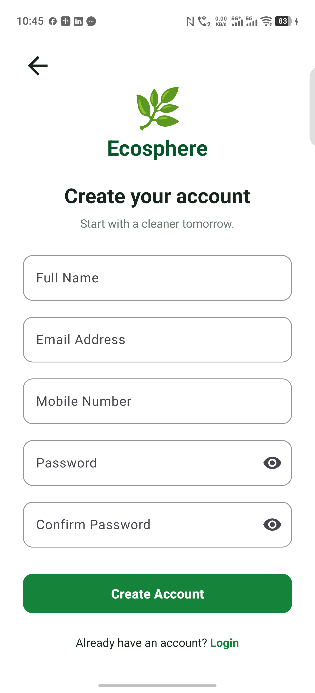
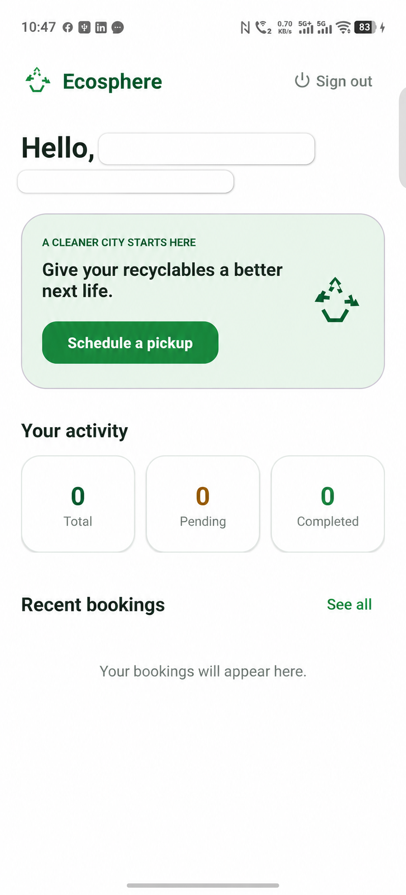
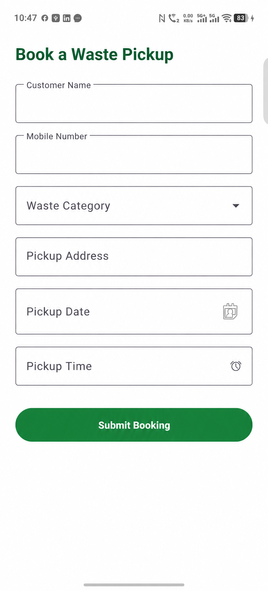
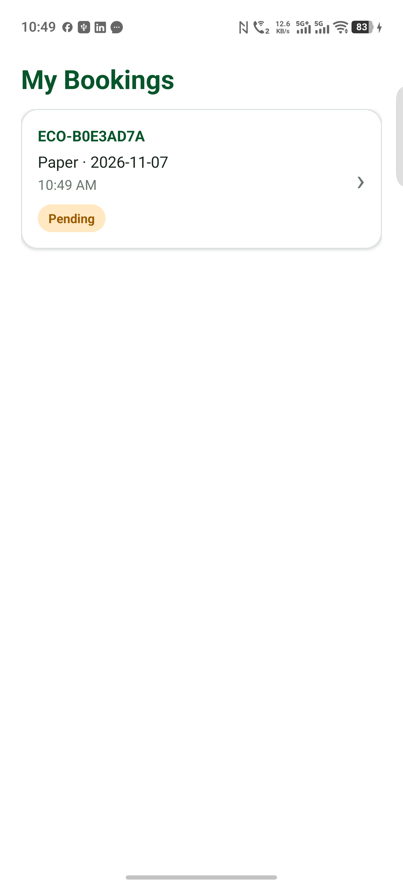
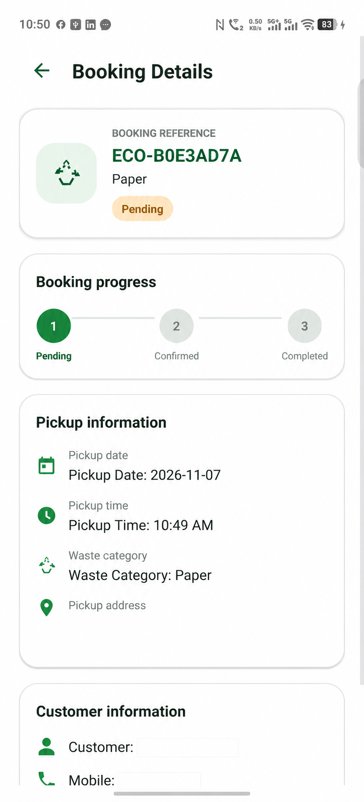

# Ecosphere Waste Pickup

Ecosphere is an Android application for household waste pickup booking. Customers can register, book a pickup, view its status, and cancel eligible bookings. The repository contains the Android client and a Node.js backend prepared for Render deployment, with application records stored in MongoDB Atlas.

Android is implemented using Kotlin and XML. iOS is not implemented; a future iOS client could be developed using Swift and SwiftUI.

## Features

- Register with a name, email, mobile number, and password; sign in with email or mobile number.
- View customer information, booking totals, and recent bookings on the dashboard.
- Create pickups for Plastic, Paper, E-waste, or General Waste.
- Review booking history and details, and track Pending, Confirmed, Completed, and Cancelled statuses.
- Cancel eligible Pending or Confirmed bookings.
- Pull to refresh the dashboard, history, and booking details.
- Cache bookings in Room on the Android device and persist backend users and bookings in MongoDB Atlas.
- Display a readable booking reference while keeping the complete UUID for API requests and navigation.

## Screenshots

<table>
  <tr>
    <td align="center"><strong>Login</strong><br></td>
    <td align="center"><strong>Registration</strong><br></td>
  </tr>
  <tr>
    <td align="center"><strong>Dashboard</strong><br></td>
    <td align="center"><strong>Create booking</strong><br></td>
  </tr>
  <tr>
    <td align="center"><strong>Booking history</strong><br></td>
    <td align="center"><strong>Booking details</strong><br></td>
  </tr>
</table>

## Technology and Architecture

- Android: Kotlin, XML, ViewBinding, Material Components, Navigation Component, Room, Retrofit, OkHttp, Gson, coroutines, and StateFlow.
- Android architecture: feature-first MVVM with manual dependency injection.
- Backend: Node.js 20+, Express 5, Mongoose, bcrypt, and JWT.
- Database: MongoDB Atlas.
- Hosting: Render Web Service.
- Session token storage: Android Keystore-backed AES-GCM encryption with app-private SharedPreferences.

```text
Android app (Kotlin/XML, Retrofit, Room)
                  |
                  | HTTPS REST API
                  v
         Render Web Service
          Node.js + Express
                  |
                  | Mongoose over TLS
                  v
           MongoDB Atlas
```

Fragments render state and handle navigation. ViewModels own UI state and actions. Repositories coordinate Retrofit and Room. In the backend, Express validates requests and enforces authentication/ownership, Mongoose validates models and queries Atlas, and JSON responses keep the existing Android API contract.

## Prerequisites

- Node.js 20 or newer and npm.
- An Android Studio emulator/device, Android SDK 36, and JDK 21 for the Android application.
- Access to the existing MongoDB Atlas organization, project, and cluster.
- GitHub access to this repository and a Render account for hosting.

## MongoDB Atlas Setup

Use the existing Atlas cluster. Do not create another cluster for this project.

1. In Atlas, choose the existing organization and project, then open **Database → Clusters** and verify the cluster is available.
2. Open **Database → Browse Collections** (Data Explorer). Create database `ecosphere_db` with collection `users`, then add collection `bookings` to the same database. Atlas can also create collections automatically on first write.
3. Open **Security → Database Access → Add New Database User**. Use password authentication and a dedicated username/password. Grant the built-in `readWrite` role on `ecosphere_db` only. Do not grant Atlas administration privileges or reuse the Atlas login password.
4. Open **Security → Network Access → Add IP Address**. Add your current public IP for local development. Avoid `0.0.0.0/0`.
5. From the existing cluster, select **Connect → Drivers → Node.js** and copy its SRV URI. Set the database path to `/ecosphere_db`. URL-encode special characters in the username/password if they appear in the URI.
6. Keep the URI in `MONGODB_URI` in the local ignored `.env` file and in Render's secret environment-variable settings. Never put it in source code, README examples, Android resources, or Git.

### Atlas access from Render

Render outbound addresses depend on the service's region. After creating the Render service, open its service details, select **Connect → Outbound**, and copy the listed CIDR ranges. Add the applicable ranges under **Atlas → Security → Network Access**. Do not assume one IP address is sufficient and do not permanently allow all IPs. Render's dedicated outbound IP sets are an optional paid workspace feature; this project does not require purchasing one.

## Database Structure

The database is `ecosphere_db`; Mongoose uses the collections `users` and `bookings`. MongoDB's internal `_id` is not exposed by the API. The existing UUID strings remain the API IDs.

### `users`

| Field | Type | Rules / purpose |
|---|---|---|
| `id` | String | Required unique UUID used in JWT subjects and booking ownership |
| `name` | String | Required, minimum two characters |
| `email` | String | Required, trimmed, lowercase, unique |
| `mobile` | String | Required, unique |
| `passwordHash` | String | Required bcrypt hash; never returned by API |

Unique indexes enforce `id`, `email`, and `mobile` uniqueness.

### `bookings`

| Field | Type | Rules / purpose |
|---|---|---|
| `id` | String | Required unique booking UUID; retained for frontend compatibility |
| `userId` | String | Required reference to `users.id`; ownership is checked on customer routes |
| `customerName`, `mobile`, `address` | String | Required pickup contact and location fields |
| `category` | String | `Plastic`, `Paper`, `E-waste`, or `General Waste` |
| `pickupDate`, `pickupTime` | String | Required preferred pickup values |
| `status` | String | `Pending`, `Confirmed`, `Completed`, or `Cancelled`; defaults to `Pending` |
| `createdAt` | String | Required ISO-8601 timestamp, used for newest-first sorting |

Indexes enforce unique booking UUIDs and support owner-scoped, newest-first listing (`userId`, `createdAt`). The `userId` relation intentionally remains a UUID string, matching existing tokens and API payloads.

## Local Backend Development

From PowerShell:

```powershell
cd backend
npm ci
Copy-Item .env.example .env
notepad .env
```

Set private values for:

```dotenv
PORT=3000
MONGODB_URI=mongodb+srv://<username>:<password>@<cluster-host>/ecosphere_db?retryWrites=true&w=majority
JWT_SECRET=<long-random-secret>
ADMIN_API_KEY=<different-long-random-secret>
```

Do not paste real values into chat or commit `.env`. `MONGO_URI` is accepted as a local compatibility alias, but use `MONGODB_URI` for new configuration. Start the backend:

```powershell
npm start
```

Check readiness, including the database connection:

```powershell
Invoke-RestMethod http://localhost:3000/health
```

`GET /health/live` checks only that the process is running. `GET /health` and the retained `GET /api/health` report readiness and return HTTP 503 if MongoDB is disconnected. The server does not start accepting requests if the initial database connection fails.

### Importing the existing local JSON data

If `backend/data/store.json` contains records you want to carry over, configure `MONGODB_URI` first, then run:

```powershell
npm run import:json-store
```

The importer preserves UUIDs and bcrypt password hashes. It inserts missing users/bookings, skips IDs already in Atlas, and does not overwrite Atlas records. It reports counts only, not personal information. Keep the local JSON file as a separate backup until you have verified the imported records. Do not commit that file.

### Backend checks

```powershell
npm test
npm run smoke
```

`npm test` runs model validation tests without a database. `npm run smoke` requires a working local `.env`/Atlas connection; it exercises registration/login, booking creation/list/detail/cancellation, administrator status transitions, and reads a booking again after restarting the server. The smoke test removes only the uniquely generated records it creates.

## Android API Configuration

The URL is configured in [`app/src/main/java/com/ecosphere/wastepickup/core/network/ApiClient.kt`](app/src/main/java/com/ecosphere/wastepickup/core/network/ApiClient.kt). Keep the trailing `/api/` path.

- Standard Android Studio emulator with a local server: `http://10.0.2.2:3000/api/`
- Deployed backend: `https://<your-render-service>.onrender.com/api/`

For independent recruiter evaluation, build the APK with the deployed HTTPS URL. Do not ship an emulator or private LAN address. After changing the URL, rebuild with `.\gradlew.bat assembleDebug`; the debug APK is at `app/build/outputs/apk/debug/app-debug.apk`.

## Render Deployment

The root `render.yaml` defines one free-plan Web Service with root directory `backend`, build command `npm ci`, start command `npm start`, and health-check path `/health`. It marks secrets as unsynchronized so their values are entered privately in the Render Dashboard.

1. Push the verified backend changes to the existing GitHub repository and branch.
2. In Render, choose **New → Blueprint**, connect the existing GitHub repository, select the branch containing `render.yaml`, and review the service before applying it. Alternatively, create a Web Service and use the same settings above.
3. Confirm the service root directory is `backend`, the runtime is Node, and the build/start commands and health path match the Blueprint. No paid plan is required by this configuration.
4. In the service's **Environment** settings, set `MONGODB_URI`, `JWT_SECRET`, and `ADMIN_API_KEY` as secret values. Use the URI for `ecosphere_db`. Do not put these values in `render.yaml`.
5. After the service exists, use **Connect → Outbound** to find its region-specific outbound CIDRs. Add these ranges to the Atlas IP Access List, then redeploy if the first startup failed while access was blocked.
6. Wait until Render reports the service as Live. Open `https://<service-name>.onrender.com/health`; expect `status: ok` and `database: connected`.
7. Enable automatic deploys from the intended Git branch if desired. Find the public API URL in the Render service overview.

Render service setup, secret entry, and production verification must be completed in the Render Dashboard. Do not claim deployment is complete based only on the presence of `render.yaml` or a successful GitHub push.

## API Documentation

All customer routes are relative to `/api/`. Customer routes marked **JWT** require `Authorization: Bearer <token>`. IDs in requests/responses remain the complete UUID strings.

| Method | Endpoint | Auth | Purpose / request |
|---|---|---|---|
| `GET` | `/health/live` | None | Process liveness |
| `GET` | `/health` | None | Service and MongoDB readiness |
| `GET` | `/api/health` | None | Backward-compatible readiness endpoint |
| `POST` | `/api/auth/register` | None | `{ "name", "email", "mobile", "password" }`; returns `{ message, user, token }` |
| `POST` | `/api/auth/login` | None | `{ "emailOrMobile", "password" }`; returns `{ message, user, token }` |
| `POST` | `/api/bookings` | JWT | `{ "id?", "customerName", "mobile", "category", "address", "pickupDate", "pickupTime" }`; returns booking directly |
| `GET` | `/api/bookings` | JWT | List the signed-in customer's bookings, newest first |
| `GET` | `/api/bookings/:id` | JWT | Read one booking owned by the signed-in customer |
| `PATCH` | `/api/bookings/:id/cancel` | JWT | Cancel an owned Pending or Confirmed booking; returns booking directly |
| `PATCH` | `/api/admin/bookings/:id/status` | `x-admin-api-key` | `{ "status": "Confirmed" }` or `{ "status": "Completed" }`; returns booking directly |

Common errors: HTTP 400 for invalid input/status or an ineligible cancellation; 401 for invalid credentials/token/admin key; 404 for an unknown or unowned booking; 409 for duplicate identities or invalid status transitions; 503 when the database or administrator configuration is unavailable. Unexpected errors return a generic 500 response without a stack trace or database details.

### Administrator status demonstration

New bookings start as `Pending`. Using Postman, send `PATCH https://<service>.onrender.com/api/admin/bookings/<full-booking-uuid>/status` with JSON `{ "status": "Confirmed" }` and header `x-admin-api-key` set to the private Render `ADMIN_API_KEY`. Send the same request with `{ "status": "Completed" }` to complete the allowed transition. The Android app never contains this key; refresh the booking screen to fetch the updated status.

## Authentication and Security

- Passwords are hashed with bcrypt before storage.
- JWTs contain the existing UUID user ID as their subject. Booking operations enforce that ownership.
- The Android app stores its session token using AES-GCM with a key held in Android Keystore.
- MongoDB access uses a dedicated database user with `readWrite` access to `ecosphere_db` only.
- Keep Atlas credentials, `JWT_SECRET`, and `ADMIN_API_KEY` in local ignored `.env` and Render secret environment variables.
- Restrict Atlas Network Access to the developer's current IP and the Render service's actual outbound ranges. Never commit credentials or allow unrestricted network access permanently.
- Render terminates HTTPS for its public web services. The app's production API URL should use HTTPS.

## Troubleshooting

- **MongoDB authentication failed:** Verify the Atlas database username/password, URL-encode reserved characters in the URI, and confirm the database user has `readWrite` on `ecosphere_db`.
- **IP not allowed / connection timeout:** Verify the current development IP or all outbound CIDRs shown under the Render service's **Connect → Outbound** are in Atlas Network Access. Do not use `0.0.0.0/0` as a permanent fix.
- **Wrong database or missing `MONGODB_URI`:** Ensure the URI path names `ecosphere_db`, and set `MONGODB_URI` in local `.env` or Render Environment settings. `MONGO_URI` is only a backwards-compatible local alias.
- **Render build failure:** Confirm `backend/package-lock.json` is committed and the build command is `npm ci` with the service root set to `backend`.
- **Render startup failure:** Check that `MONGODB_URI` and `JWT_SECRET` are configured, then inspect sanitized runtime errors and Atlas IP access.
- **Admin endpoint returns 503:** Configure `ADMIN_API_KEY` in the backend environment. Never place it in Android source.
- **Duplicate key or validation response:** Check unique email/mobile/UUID constraints and required booking fields/categories.
- **Invalid ObjectId:** Public API IDs are UUID strings; do not replace them with MongoDB `_id` values.
- **Android network error:** Confirm `ApiClient.kt` points to the deployed HTTPS `/api/` URL and rebuild the APK after changing it.

## Assignment Scope and Known Limitations

- Android is implemented using Kotlin/XML. iOS is not implemented; it could be developed using Swift and SwiftUI.
- Android Room provides device-local booking cache; MongoDB Atlas is the persistent shared backend store.
- Automated UI/instrumentation tests and Play Store/iOS releases are not included. Backend model tests and an Atlas-backed smoke test are available.
- Render free services may have cold starts or plan limitations; allow the first request after inactivity extra time.
- MongoDB Atlas backup/retention configuration depends on the existing cluster tier and settings and has not been assumed by this project.
- The generated debug APK is for assignment demonstration and testing, not Play Store release.

## Change Log

- Replaced backend JSON-file/runtime-array operations with Mongoose models and MongoDB queries while retaining existing API endpoints and UUID response fields.
- Added safe MongoDB startup, readiness/liveness health routes, graceful shutdown, and sanitized database error responses.
- Added an idempotent importer for legacy local JSON records; it skips existing records and does not overwrite Atlas data.
- Added backend model tests and a local Atlas-backed smoke test that checks API behavior and persistence after a service restart.
- Added `.env.example` MongoDB configuration and a Render Blueprint with secret placeholders only.
- Updated this README with the database schema, Atlas network setup, API reference, Render steps, and troubleshooting guide.

## Repository Structure

```text
app/src/main/java/com/ecosphere/wastepickup/   Android features, MVVM, Room, API client
backend/server.js                              Express API and startup
backend/config/database.js                    MongoDB connection
backend/models/                                User and booking schemas
backend/scripts/                               Safe legacy importer and smoke test
backend/test/                                  Backend model tests
render.yaml                                   Render Web Service Blueprint
docs/screenshots/                              Android screen images
```
